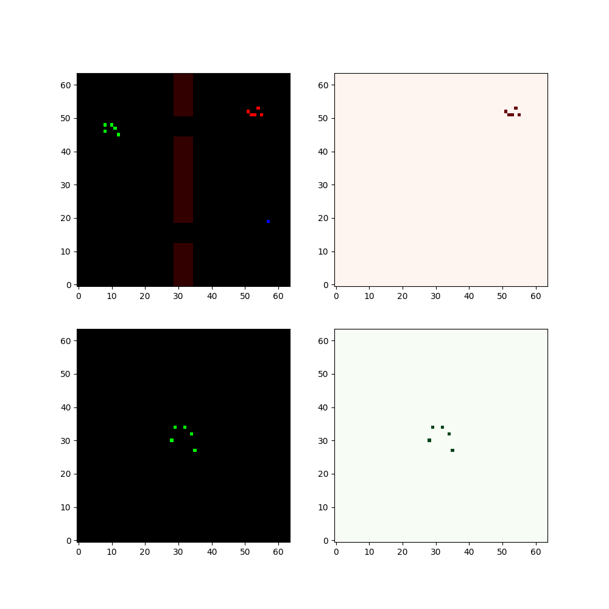

# Sc2Jax: Standalone High-Throughput MARL Framework

Sc2Jax is a lightweight, high-performance StarCraft II research framework built entirely in JAX. It provides a standalone ecosystem for training and benchmarking Reinforcement Learning agents with 100% JAX-native control flow, multi-agent vectorization, and physical verification.

## 🚀 Key Features

- **JAX-Native Physics**: All environment logic (collisions, combat, rewards) is implemented in JAX, enabling seamless `vmap` and `jit` transformations.
- **High Throughput**: Achieves >110k SPS for raw environment steps and >17k SPS during multi-epoch PPO training on Apple Silicon.
- **Tri-Algorithm Stack**: Production-ready implementations of **A2C**, **PPO**, and **MaskPPO** (with action-masking).
- **Standalone Architecture**: Zero dependency on heavy external MARL libraries; local `base.py` provides all necessary abstractions.
- **Physical Fidelity**: Includes continuous kinematics, projectile ballistics, and heterogeneous unit types (Melee, Ranged, Tank).

## 🛠 Installation

```bash
# Ensure JAX and Flax are installed
pip install jax jaxlib flax optax chex gymnasium
# Clone and set PYTHONPATH
export PYTHONPATH=$PYTHONPATH:.
```

## 📊 Benchmarks (Apple Silicon)

| Scenario | Envs | Steps Per Second (SPS) |
|---|---|---|
| **Random Policy** | 32 | **110,320** |
| **A2C** | 64 | **24,541** |
| **MaskPPO** | 32 | **19,046** |
| **Standard PPO** | 32 | **17,057** |

## 📖 Documentation

| Resource | Description |
|---|---|
| [Instructions.md](Instructions.md) | Setup, loading environments/agents, training, rendering, configuration |
| [Architecture](ARCHITECTURE.md) | Deep-dive into the environment engine and algorithm stack |
| [Contributing](CONTRIBUTING.md) | Coding standards, JIT rules, PR process, test expectations |
| [Mechanics](JaxSC2/env/mechanics.md) | Physics equations: collisions, velocity integration, combat, fog of war |
| [Unit Reference](JaxSC2/env/units.md) | Unit stats, weapons, type advantage matrix, design rationale |
| [Map Authoring](JaxSC2/maps/README.md) | Map structure, variants, bridge strategy, creating custom maps |
| [Test Suite](JaxSC2/tests/README.md) | Running tests, adding new tests, debugging JIT errors |
| [Common Utilities](algorithms/common/README.md) | GAE, Welford RMS, action encoding, checkpointing |
| [Visualizations](VISUALIZATIONS.md) | All demo scripts with CLI args, agent logic, customization guide |
| [Algorithm READMEs](algorithms/README.md) | PPO, MaskPPO, A2C overview |

## 📖 Library Structure

- `JaxSC2/`: Core environment engine.
  - `env/`: Physics, base classes, and `JaxSC2Env`. **See:** [mechanics.md](JaxSC2/env/mechanics.md), [units.md](JaxSC2/env/units.md)
  - `maps/`: Terrain constraints, rewards, and variants. **See:** [map authoring guide](JaxSC2/maps/README.md)
  - `tests/`: Mechanics and integrity test suites. **See:** [test suite guide](JaxSC2/tests/README.md)
- `algorithms/`: Standardized RL implementations. **See:** [common utilities](algorithms/common/README.md)
  - `ppo/`: Proximal Policy Optimization.
  - `mask_ppo/`: PPO with invalid-action masking.
  - `a2c/`: Advantage Actor-Critic.

## 🧪 Quick Start

Ensure you have the dependencies installed:
```bash
pip install -r requirements.txt
# or manually: pip install jax flax optax chex gymnasium pygame imageio matplotlib tensorboardX
```

Set up paths:
```bash
export PYTHONPATH=$PYTHONPATH:.
```

Run the PPO smoke test to verify JIT stability:
```bash
python algorithms/ppo/tests/test_ppo_jit.py
```

Launch training:
```python
from algorithms.mask_ppo import MaskPPO
from JaxSC2.env.env import JaxSC2Env

config = {"NUM_ENVS": 32, "ROLLOUT_LEN": 512, "UPDATE_EPOCHS": 10}
env = JaxSC2Env(variant_name="V1_Base")
model = MaskPPO(config=config)
model.train(env, total_steps=30_000_000)
```

The default `balanced` reward profile gives both beacon progress and approach to
the enemy centroid a coefficient of 2.0, and either victory a +25 terminal bonus.
Damage rewards (+0.005/HP), damage penalties (-0.005/HP), kills (+0.2), defeat
(-10), and timeout (-15) are unchanged. Either victory still ends the episode;
equal objective weights do not guarantee equally frequent combat/navigation wins.
Use `JaxSC2Env(..., reward_profile="legacy")` to reproduce the earlier rewards
(combat approach 0.5, combat victory +10). See the [reward reference](JaxSC2/maps/README.md).

For a fresh, isolated PPO comparison run:

```bash
python examples/run_ppo.py --reward-profile balanced --total-steps 30000000 --background
```

The launcher records the reward profile and exact weights in `config.json` and
refuses to resume a run under different rewards. Older run configurations without
a reward profile are treated as `legacy`; resume them with `--reward-profile legacy`.

Training output reports mean **episode reward**: the sum of raw environment
rewards through termination, averaged over episodes completed since the previous
log. Partial episodes carry across rollouts; output is `n/a` until one completes.
TensorBoard uses `train/episode_reward`, `train/episode_length`, and
`train/completed_episodes`. The separate `train/step_reward` metric is the latest
rollout's per-step mean, not an episode return. This applies to PPO, MaskPPO, and A2C.

To resume a launcher run, use the same arguments and run directory with
`--resume /path/to/checkpoint.pkl`. `--total-steps` remains the overall target,
not additional steps. Parameters, optimizer state, reward normalization, and
global step are restored; environments and partial episode counters restart.

## 🎬 Visualizations

### Scripted Beacon and Combat Baselines

Browse the [scripted beacon and combat gallery](docs/SCRIPTED_AGENTS.md) directly
on GitHub: 108 animated demos with side-by-side agents, settings, and outcomes.

Run deterministic per-unit agents across all nine scenarios and the collision,
armor, fog, and latency settings, with a GIF gallery and JSON metrics:

```bash
conda run --no-capture-output -n twobridge env PYTHONPATH=. \
  python -m JaxSC2.scripted.evaluate --render all
```

Open `runs/scripted_evaluation/index.html` to compare the behavior. The beacon
agent routes through bridges; the combat agent approaches known enemies and
attacks within each unit's weapon range. See the [scripted agent guide](JaxSC2/scripted/README.md)
for opponent modes, seeds, and focused evaluations.

Eleven [enemy modes](JaxSC2/scripted/README.md#enemy-modes) are available:
`static`, `guard`, `patrol`, `aggressive`, `beacon_defender`, `bridge_blocker`,
`pursuer`, `kiter`, `focus_fire`, `ambusher`, and `adaptive_defender`.
Choose one with `examples/run_ppo.py --enemy-mode MODE`, or compare modes using
`python -m JaxSC2.scripted.evaluate --enemy-modes all --variants V2_Base --settings baseline`.

Generate demo GIFs:
```bash
python JaxSC2/visualizations/render_demo.py        # Smart + chaos agent demos
python JaxSC2/visualizations/demo_suite.py          # Full variant suite with CLI filters
python JaxSC2/visualizations/run_ui.py              # Interactive Pygame window (press key to step)
```

See [VISUALIZATIONS.md](VISUALIZATIONS.md) for the full script reference.

## 🎬 Showcase

### Trained Agent — Combat (V2_Combat)

A MaskPPO policy trained for 30M steps on V2_Combat (5v5). The agent demonstrates coordinated bridge crossing, composition-aware targeting (Melee→Ranged→Tank advantage exploitation), and projectile ballistics engagement.



### Navigation Variants (5v3 / 5v5 / 5v8)

The agent navigates the TwoBridge map across three enemy-strength variants. Units route through the correct bridge based on spawn position, maintain formation during crossing, and reach the beacon even under heavy enemy pressure.

| Variant | Strength | Description |
|---|---|---|
| **5v3 Navigate** | Light (3 enemies) | Quick bridge crossing, minimal engagement delay |
| **5v5 Navigate** | Medium (5 enemies) | Split-force strategy: half units cross while others engage |
| **5v8 Navigate** | Heavy (8 enemies) | Overwhelming numbers require timing — cross when enemy is committed elsewhere |

> GIFs generated with `python JaxSC2/visualizations/demo_suite.py --mode navigate`

## 🤝 Contributing

See [CONTRIBUTING.md](CONTRIBUTING.md) for coding standards, the PR process, and test expectations.
See [ARCHITECTURE.md](ARCHITECTURE.md) for a system-level overview before contributing.
