# Scripted beacon and combat agents

[Back to the main README](../README.md) · [Agent implementation and usage](../JaxSC2/scripted/README.md)

This is the GitHub-readable Markdown version of the local HTML evaluation galleries.
These are deterministic scripted baselines, **not trained PPO policies**. Each beacon/combat
pair uses the same spawn seed (42), with a maximum of 300 simulation steps.

The **beacon agent** routes through bridges toward the beacon. The **combat agent**
approaches enemies and attacks within weapon range. Blue units are allies, red units
are enemies, the cyan marker is the beacon, and yellow markers are projectiles.
Both teams obey the same radius-aware ditch boundaries. Fog runs use sightings and
memory only; static enemies remain stationary but can still auto-attack.

## Recorded results

Across these 108 episodes, beacon agents reached the beacon in
54/54 episodes.
Combat agents defeated all enemies in
19/54 episodes.
All 108 episodes recorded zero terrain violations and all units in map bounds.
A timeout is **not** a combat win; enemy damage shows partial progress separately.
Returns below are raw episode reward sums.

V1 has 5 allies versus 3 enemies, V2 is 5 versus 5, and V3 is 5 versus 8.
Base, Combat, and Navigate are the environment's scenario variants.

- [Baseline](#baseline)
- [Without unit collisions](#without-unit-collisions)
- [Without armor](#without-armor)
- [Fog of war](#fog-of-war)
- [Action latency](#action-latency)
- [Active opponents](#active-opponents)
- [Reproduce the galleries](#reproduce-the-galleries)

## Settings matrix

[Full settings and metrics (JSON)](assets/scripted/scripted_evaluation/results.json)

The five settings below use static opponents. Baseline enables collision and armor,
disables fog, and uses zero action latency. Each other setting changes only the
named option; disabling unit collisions does not disable terrain constraints.

### Baseline

| Variant | Beacon agent | Combat agent |
| --- | --- | --- |
| V1_Base | 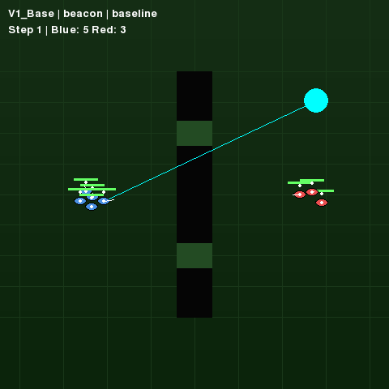<br>**beacon reached** · 86 steps<br>Return 26.32 · Enemy damage 0.0<br>Terrain violations: 0 | <br>**enemies defeated** · 267 steps<br>Return 12.40 · Enemy damage 345.0<br>Terrain violations: 0 |
| V1_Combat | <br>**beacon reached** · 78 steps<br>Return 25.97 · Enemy damage 0.0<br>Terrain violations: 0 | <br>**enemies defeated** · 199 steps<br>Return 11.33 · Enemy damage 345.0<br>Terrain violations: 0 |
| V1_Navigate | <br>**beacon reached** · 19 steps<br>Return 25.25 · Enemy damage 0.0<br>Terrain violations: 0 | 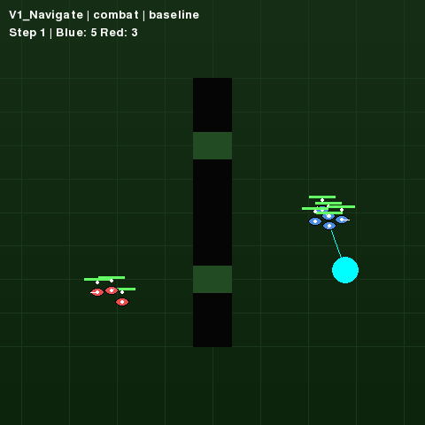<br>**enemies defeated** · 224 steps<br>Return 10.93 · Enemy damage 345.0<br>Terrain violations: 0 |
| V2_Base | <br>**beacon reached** · 86 steps<br>Return 26.32 · Enemy damage 0.0<br>Terrain violations: 0 | 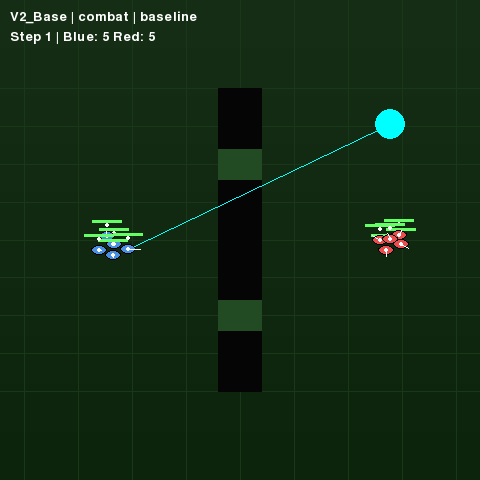<br>**timeout** · 300 steps<br>Return -12.57 · Enemy damage 339.1<br>Terrain violations: 0 |
| V2_Combat | <br>**beacon reached** · 78 steps<br>Return 25.96 · Enemy damage 0.0<br>Terrain violations: 0 | <br>**timeout** · 300 steps<br>Return -13.13 · Enemy damage 366.2<br>Terrain violations: 0 |
| V2_Navigate | 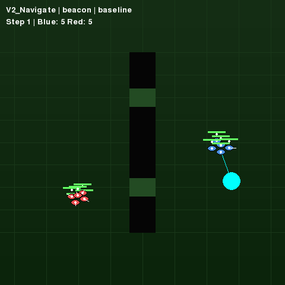<br>**beacon reached** · 19 steps<br>Return 25.25 · Enemy damage 0.0<br>Terrain violations: 0 | <br>**enemies defeated** · 276 steps<br>Return 11.73 · Enemy damage 490.0<br>Terrain violations: 0 |
| V3_Base | <br>**beacon reached** · 86 steps<br>Return 26.32 · Enemy damage 0.0<br>Terrain violations: 0 | <br>**timeout** · 300 steps<br>Return -12.17 · Enemy damage 537.0<br>Terrain violations: 0 |
| V3_Combat | <br>**beacon reached** · 79 steps<br>Return 25.99 · Enemy damage 15.0<br>Terrain violations: 0 | <br>**timeout** · 300 steps<br>Return -13.85 · Enemy damage 432.5<br>Terrain violations: 0 |
| V3_Navigate | 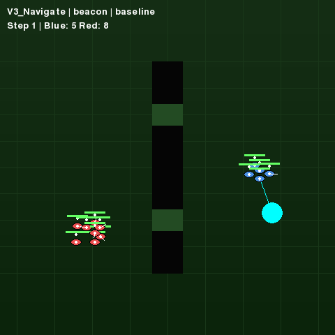<br>**beacon reached** · 19 steps<br>Return 25.25 · Enemy damage 0.0<br>Terrain violations: 0 | <br>**timeout** · 300 steps<br>Return -14.11 · Enemy damage 459.0<br>Terrain violations: 0 |

### Without unit collisions

| Variant | Beacon agent | Combat agent |
| --- | --- | --- |
| V1_Base | 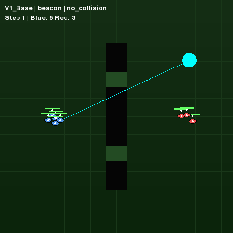<br>**beacon reached** · 86 steps<br>Return 26.34 · Enemy damage 0.0<br>Terrain violations: 0 | 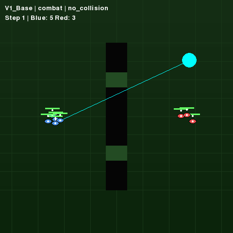<br>**enemies defeated** · 237 steps<br>Return 12.43 · Enemy damage 345.0<br>Terrain violations: 0 |
| V1_Combat | <br>**beacon reached** · 78 steps<br>Return 25.99 · Enemy damage 0.0<br>Terrain violations: 0 | 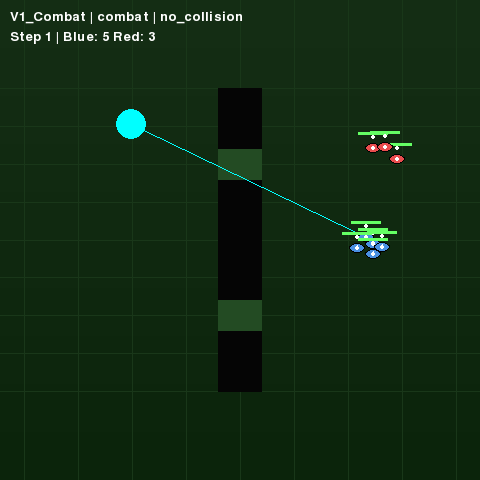<br>**enemies defeated** · 207 steps<br>Return 11.39 · Enemy damage 345.0<br>Terrain violations: 0 |
| V1_Navigate | 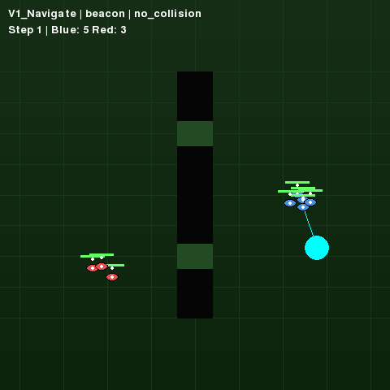<br>**beacon reached** · 18 steps<br>Return 25.27 · Enemy damage 0.0<br>Terrain violations: 0 | 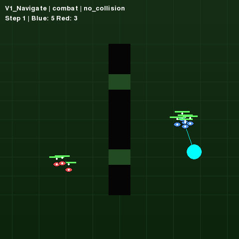<br>**enemies defeated** · 268 steps<br>Return 10.87 · Enemy damage 345.0<br>Terrain violations: 0 |
| V2_Base | <br>**beacon reached** · 86 steps<br>Return 26.34 · Enemy damage 0.0<br>Terrain violations: 0 | 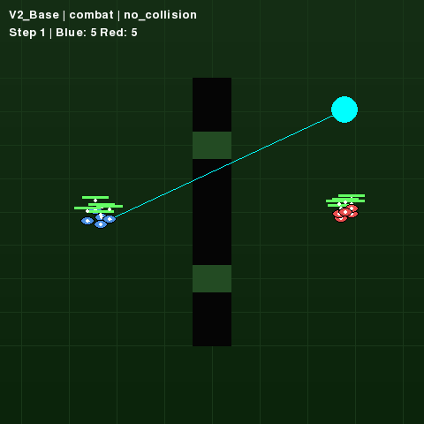<br>**timeout** · 300 steps<br>Return -12.07 · Enemy damage 413.8<br>Terrain violations: 0 |
| V2_Combat | 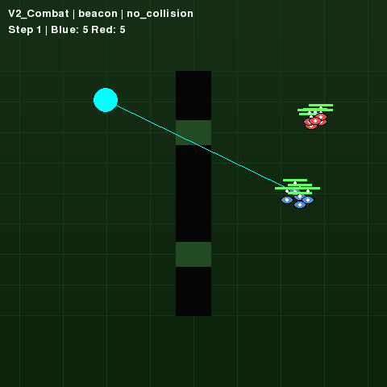<br>**beacon reached** · 78 steps<br>Return 25.98 · Enemy damage 0.0<br>Terrain violations: 0 | <br>**enemies defeated** · 287 steps<br>Return 12.25 · Enemy damage 490.0<br>Terrain violations: 0 |
| V2_Navigate | 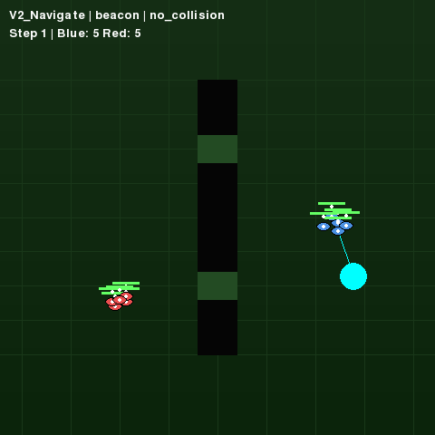<br>**beacon reached** · 18 steps<br>Return 25.27 · Enemy damage 0.0<br>Terrain violations: 0 | <br>**timeout** · 300 steps<br>Return -13.35 · Enemy damage 454.0<br>Terrain violations: 0 |
| V3_Base | 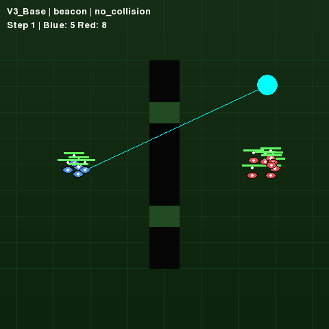<br>**beacon reached** · 86 steps<br>Return 26.34 · Enemy damage 0.0<br>Terrain violations: 0 | 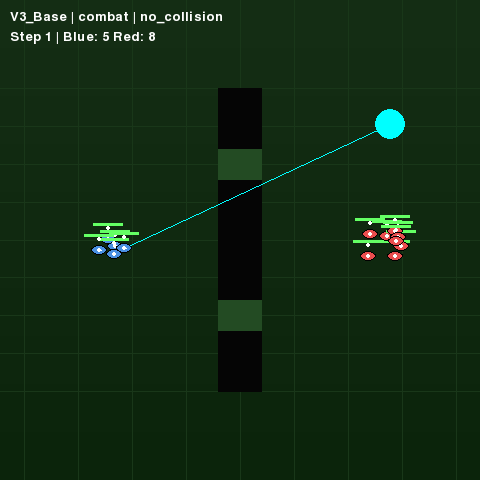<br>**timeout** · 300 steps<br>Return -13.34 · Enemy damage 350.5<br>Terrain violations: 0 |
| V3_Combat | <br>**beacon reached** · 78 steps<br>Return 26.02 · Enemy damage 20.0<br>Terrain violations: 0 | 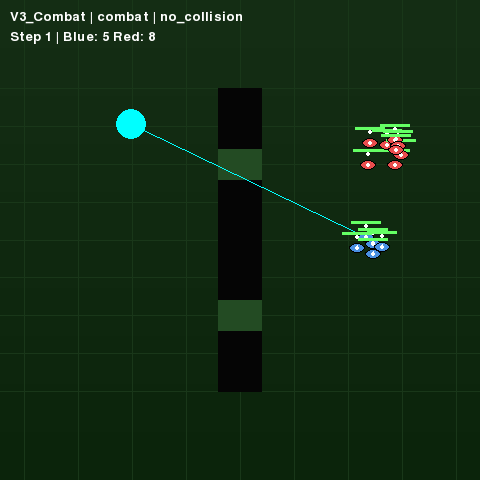<br>**timeout** · 300 steps<br>Return -12.11 · Enemy damage 501.0<br>Terrain violations: 0 |
| V3_Navigate | <br>**beacon reached** · 18 steps<br>Return 25.27 · Enemy damage 0.0<br>Terrain violations: 0 | 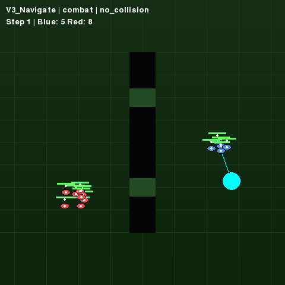<br>**timeout** · 300 steps<br>Return -15.11 · Enemy damage 426.6<br>Terrain violations: 0 |

### Without armor

| Variant | Beacon agent | Combat agent |
| --- | --- | --- |
| V1_Base | <br>**beacon reached** · 86 steps<br>Return 26.32 · Enemy damage 0.0<br>Terrain violations: 0 | <br>**enemies defeated** · 235 steps<br>Return 12.52 · Enemy damage 345.0<br>Terrain violations: 0 |
| V1_Combat | 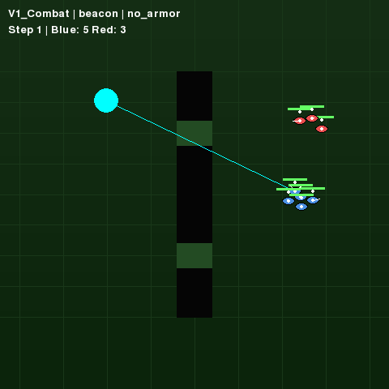<br>**beacon reached** · 78 steps<br>Return 25.97 · Enemy damage 0.0<br>Terrain violations: 0 | 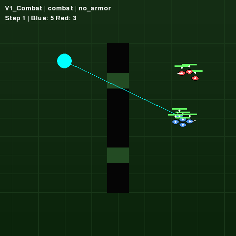<br>**enemies defeated** · 180 steps<br>Return 11.61 · Enemy damage 345.0<br>Terrain violations: 0 |
| V1_Navigate | <br>**beacon reached** · 19 steps<br>Return 25.25 · Enemy damage 0.0<br>Terrain violations: 0 | 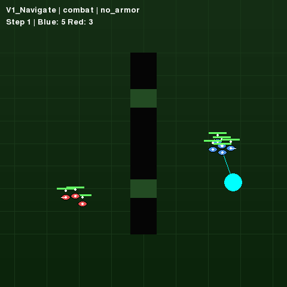<br>**enemies defeated** · 214 steps<br>Return 10.63 · Enemy damage 345.0<br>Terrain violations: 0 |
| V2_Base | 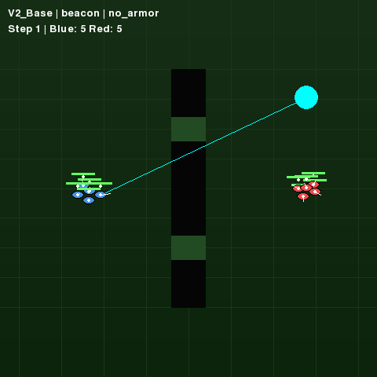<br>**beacon reached** · 86 steps<br>Return 26.32 · Enemy damage 0.0<br>Terrain violations: 0 | <br>**timeout** · 300 steps<br>Return -13.54 · Enemy damage 356.8<br>Terrain violations: 0 |
| V2_Combat | <br>**beacon reached** · 78 steps<br>Return 25.96 · Enemy damage 0.0<br>Terrain violations: 0 | <br>**enemies defeated** · 214 steps<br>Return 12.27 · Enemy damage 490.0<br>Terrain violations: 0 |
| V2_Navigate | <br>**beacon reached** · 19 steps<br>Return 25.25 · Enemy damage 0.0<br>Terrain violations: 0 | <br>**enemies defeated** · 238 steps<br>Return 11.68 · Enemy damage 490.0<br>Terrain violations: 0 |
| V3_Base | 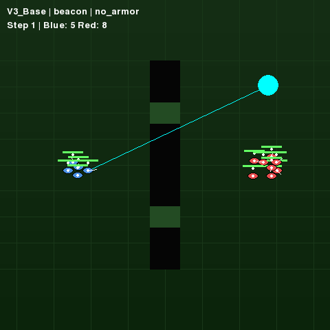<br>**beacon reached** · 86 steps<br>Return 26.32 · Enemy damage 0.0<br>Terrain violations: 0 | <br>**timeout** · 300 steps<br>Return -12.12 · Enemy damage 600.0<br>Terrain violations: 0 |
| V3_Combat | <br>**beacon reached** · 79 steps<br>Return 25.98 · Enemy damage 15.0<br>Terrain violations: 0 | <br>**timeout** · 300 steps<br>Return -13.94 · Enemy damage 481.5<br>Terrain violations: 0 |
| V3_Navigate | <br>**beacon reached** · 19 steps<br>Return 25.25 · Enemy damage 0.0<br>Terrain violations: 0 | <br>**timeout** · 300 steps<br>Return -14.71 · Enemy damage 457.0<br>Terrain violations: 0 |

### Fog of war

| Variant | Beacon agent | Combat agent |
| --- | --- | --- |
| V1_Base | 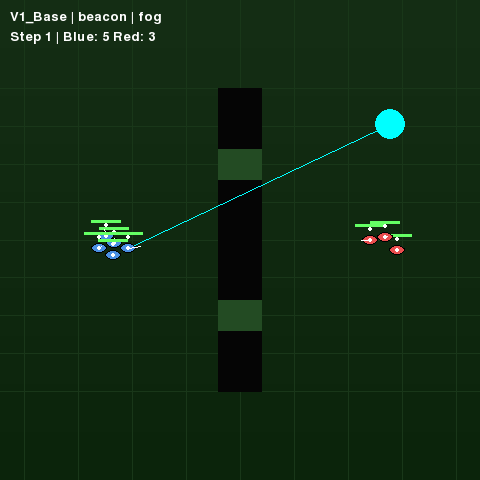<br>**beacon reached** · 86 steps<br>Return 26.32 · Enemy damage 0.0<br>Terrain violations: 0 | <br>**timeout** · 300 steps<br>Return -13.22 · Enemy damage 223.2<br>Terrain violations: 0 |
| V1_Combat | 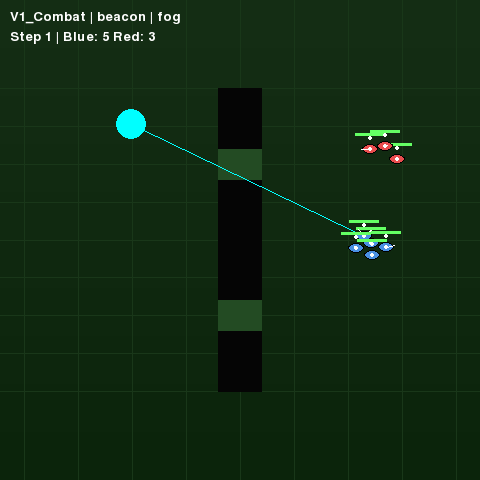<br>**beacon reached** · 78 steps<br>Return 25.97 · Enemy damage 0.0<br>Terrain violations: 0 | 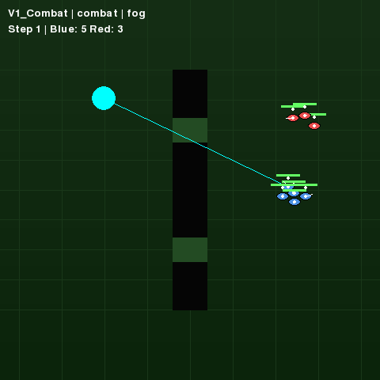<br>**enemies defeated** · 251 steps<br>Return 11.75 · Enemy damage 345.0<br>Terrain violations: 0 |
| V1_Navigate | 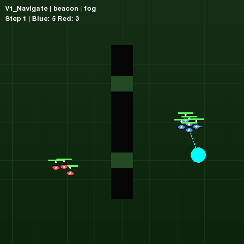<br>**beacon reached** · 19 steps<br>Return 25.25 · Enemy damage 0.0<br>Terrain violations: 0 | <br>**timeout** · 300 steps<br>Return -13.94 · Enemy damage 344.2<br>Terrain violations: 0 |
| V2_Base | 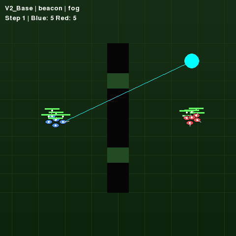<br>**beacon reached** · 86 steps<br>Return 26.32 · Enemy damage 0.0<br>Terrain violations: 0 | 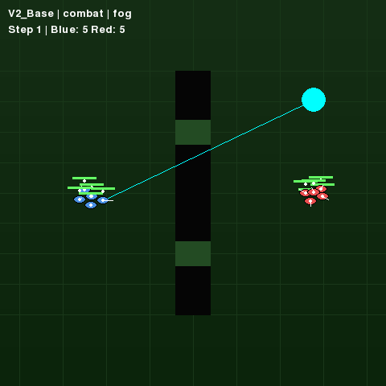<br>**timeout** · 300 steps<br>Return -14.11 · Enemy damage 223.2<br>Terrain violations: 0 |
| V2_Combat | 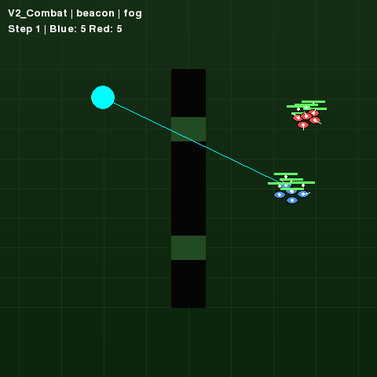<br>**beacon reached** · 78 steps<br>Return 25.96 · Enemy damage 0.0<br>Terrain violations: 0 | 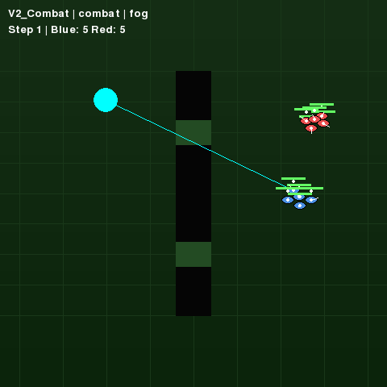<br>**enemies defeated** · 287 steps<br>Return 12.11 · Enemy damage 490.0<br>Terrain violations: 0 |
| V2_Navigate | 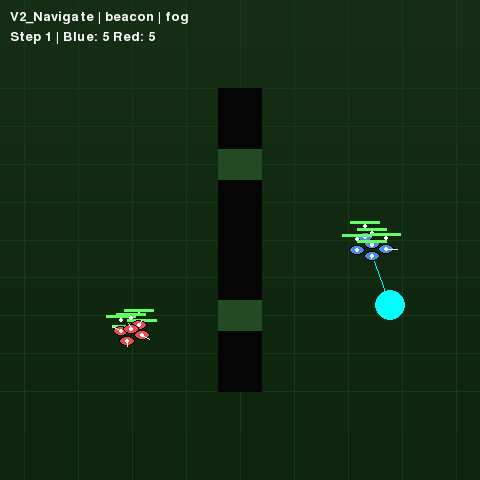<br>**beacon reached** · 19 steps<br>Return 25.25 · Enemy damage 0.0<br>Terrain violations: 0 | 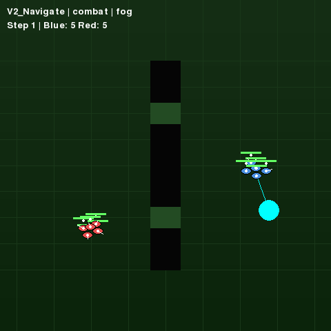<br>**timeout** · 300 steps<br>Return -13.83 · Enemy damage 423.0<br>Terrain violations: 0 |
| V3_Base | 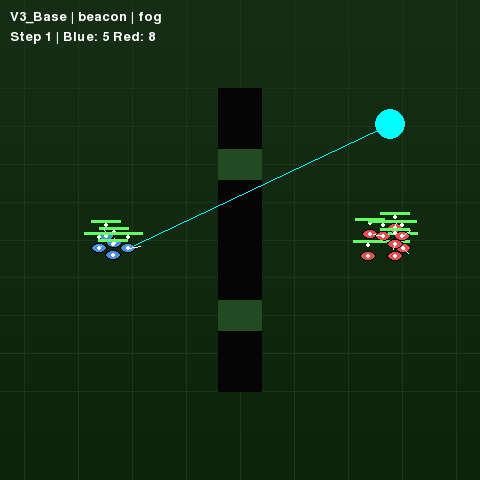<br>**beacon reached** · 86 steps<br>Return 26.32 · Enemy damage 0.0<br>Terrain violations: 0 | 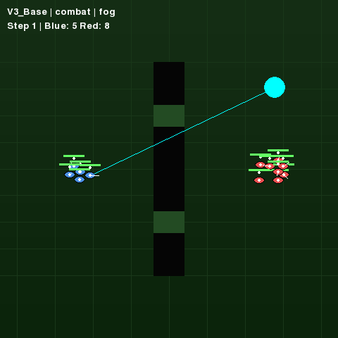<br>**timeout** · 300 steps<br>Return -14.35 · Enemy damage 206.4<br>Terrain violations: 0 |
| V3_Combat | 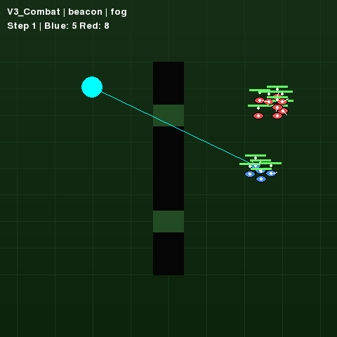<br>**beacon reached** · 79 steps<br>Return 26.08 · Enemy damage 30.0<br>Terrain violations: 0 | 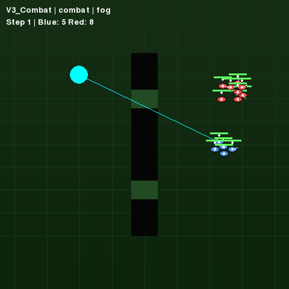<br>**timeout** · 300 steps<br>Return -14.39 · Enemy damage 353.0<br>Terrain violations: 0 |
| V3_Navigate | 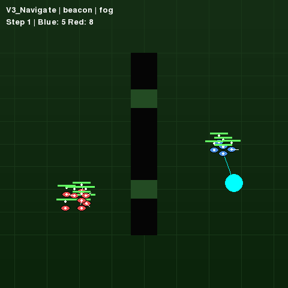<br>**beacon reached** · 19 steps<br>Return 25.25 · Enemy damage 0.0<br>Terrain violations: 0 | <br>**timeout** · 300 steps<br>Return -14.96 · Enemy damage 390.3<br>Terrain violations: 0 |

### Action latency

Commands are delayed by three simulation steps.

| Variant | Beacon agent | Combat agent |
| --- | --- | --- |
| V1_Base | 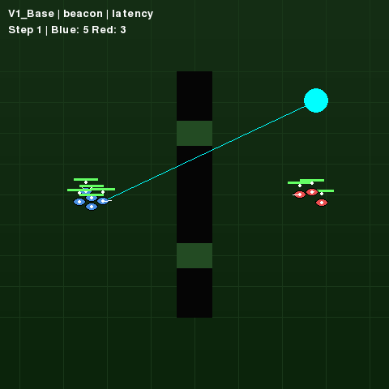<br>**beacon reached** · 88 steps<br>Return 26.27 · Enemy damage 0.0<br>Terrain violations: 0 | <br>**timeout** · 300 steps<br>Return -12.48 · Enemy damage 321.2<br>Terrain violations: 0 |
| V1_Combat | 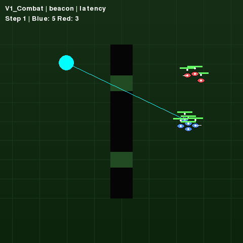<br>**beacon reached** · 84 steps<br>Return 25.96 · Enemy damage 0.0<br>Terrain violations: 0 | <br>**enemies defeated** · 171 steps<br>Return 11.80 · Enemy damage 345.0<br>Terrain violations: 0 |
| V1_Navigate | <br>**beacon reached** · 21 steps<br>Return 25.25 · Enemy damage 0.0<br>Terrain violations: 0 | <br>**timeout** · 300 steps<br>Return -15.04 · Enemy damage 196.5<br>Terrain violations: 0 |
| V2_Base | 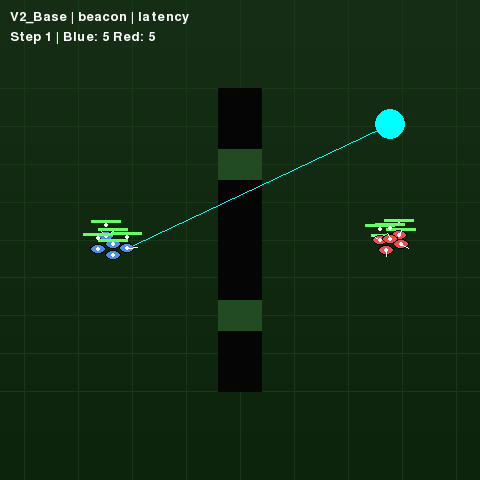<br>**beacon reached** · 88 steps<br>Return 26.28 · Enemy damage 0.0<br>Terrain violations: 0 | <br>**timeout** · 300 steps<br>Return -11.95 · Enemy damage 400.4<br>Terrain violations: 0 |
| V2_Combat | 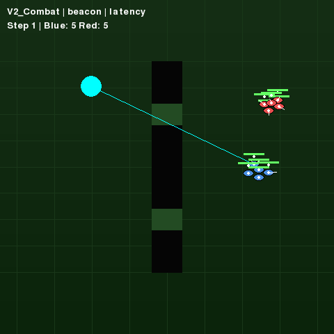<br>**beacon reached** · 84 steps<br>Return 25.96 · Enemy damage 0.0<br>Terrain violations: 0 | <br>**enemies defeated** · 251 steps<br>Return 12.81 · Enemy damage 490.0<br>Terrain violations: 0 |
| V2_Navigate | <br>**beacon reached** · 21 steps<br>Return 25.25 · Enemy damage 0.0<br>Terrain violations: 0 | <br>**timeout** · 300 steps<br>Return -15.12 · Enemy damage 228.5<br>Terrain violations: 0 |
| V3_Base | 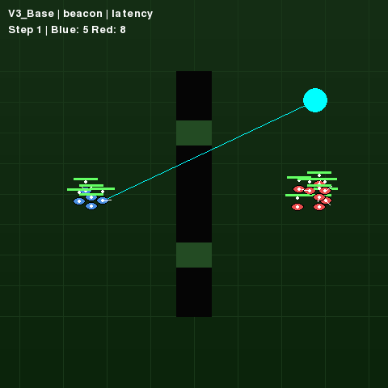<br>**beacon reached** · 88 steps<br>Return 26.28 · Enemy damage 0.0<br>Terrain violations: 0 | <br>**timeout** · 300 steps<br>Return -13.77 · Enemy damage 330.0<br>Terrain violations: 0 |
| V3_Combat | 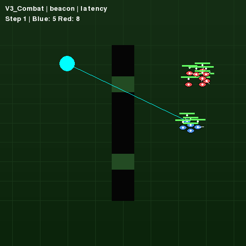<br>**beacon reached** · 86 steps<br>Return 25.92 · Enemy damage 15.0<br>Terrain violations: 0 | <br>**timeout** · 300 steps<br>Return -13.27 · Enemy damage 387.0<br>Terrain violations: 0 |
| V3_Navigate | 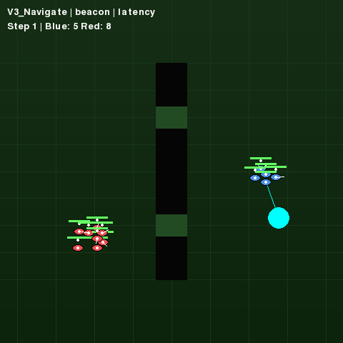<br>**beacon reached** · 21 steps<br>Return 25.25 · Enemy damage 0.0<br>Terrain violations: 0 | <br>**timeout** · 300 steps<br>Return -14.60 · Enemy damage 302.5<br>Terrain violations: 0 |

## Active opponents

[Full settings and metrics (JSON)](assets/scripted/scripted_opponents/results.json)

These runs use the baseline settings on the Combat variants, with moving enemy AI.

### Guard opponents

| Variant | Beacon agent | Combat agent |
| --- | --- | --- |
| V1_Combat | <br>**beacon reached** · 77 steps<br>Return 26.16 · Enemy damage 54.0<br>Terrain violations: 0 | <br>**enemies defeated** · 296 steps<br>Return 11.37 · Enemy damage 345.0<br>Terrain violations: 0 |
| V2_Combat | <br>**beacon reached** · 78 steps<br>Return 25.91 · Enemy damage 53.8<br>Terrain violations: 0 | <br>**timeout** · 300 steps<br>Return -13.42 · Enemy damage 334.6<br>Terrain violations: 0 |
| V3_Combat | <br>**beacon reached** · 78 steps<br>Return 26.02 · Enemy damage 63.2<br>Terrain violations: 0 | <br>**timeout** · 300 steps<br>Return -13.94 · Enemy damage 454.2<br>Terrain violations: 0 |

### Patrol opponents

| Variant | Beacon agent | Combat agent |
| --- | --- | --- |
| V1_Combat | <br>**beacon reached** · 78 steps<br>Return 25.89 · Enemy damage 0.0<br>Terrain violations: 0 | <br>**timeout** · 300 steps<br>Return -13.12 · Enemy damage 258.0<br>Terrain violations: 0 |
| V2_Combat | 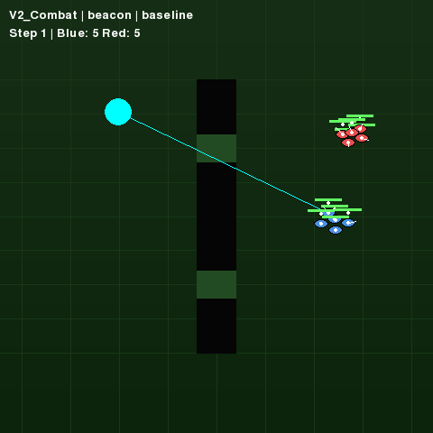<br>**beacon reached** · 78 steps<br>Return 25.90 · Enemy damage 0.0<br>Terrain violations: 0 | 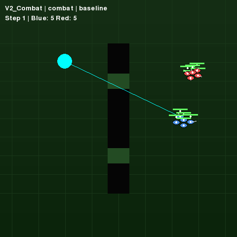<br>**timeout** · 300 steps<br>Return -12.22 · Enemy damage 447.0<br>Terrain violations: 0 |
| V3_Combat | 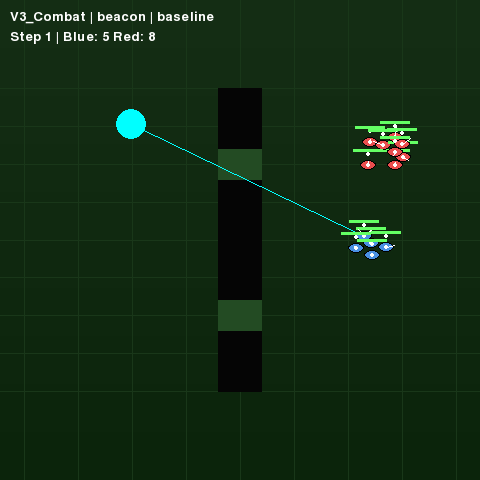<br>**beacon reached** · 78 steps<br>Return 25.91 · Enemy damage 0.0<br>Terrain violations: 0 | <br>**timeout** · 300 steps<br>Return -12.28 · Enemy damage 546.3<br>Terrain violations: 0 |

### Aggressive opponents

| Variant | Beacon agent | Combat agent |
| --- | --- | --- |
| V1_Combat | <br>**beacon reached** · 79 steps<br>Return 26.20 · Enemy damage 66.0<br>Terrain violations: 0 | 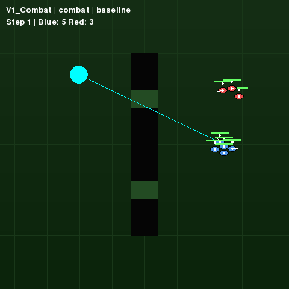<br>**enemies defeated** · 240 steps<br>Return 11.27 · Enemy damage 345.0<br>Terrain violations: 0 |
| V2_Combat | <br>**beacon reached** · 79 steps<br>Return 25.91 · Enemy damage 67.0<br>Terrain violations: 0 | <br>**timeout** · 300 steps<br>Return -14.71 · Enemy damage 327.7<br>Terrain violations: 0 |
| V3_Combat | 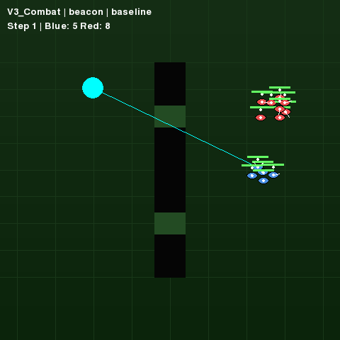<br>**beacon reached** · 78 steps<br>Return 25.78 · Enemy damage 59.2<br>Terrain violations: 0 | <br>**timeout** · 300 steps<br>Return -13.85 · Enemy damage 382.9<br>Terrain violations: 0 |

## Reproduce the galleries

From the repository root, using the `twobridge` environment:

```bash
conda run --no-capture-output -n twobridge env PYTHONPATH=. \
  python -m JaxSC2.scripted.evaluate --render all

conda run --no-capture-output -n twobridge env PYTHONPATH=. \
  python -m JaxSC2.scripted.evaluate \
  --variants V1_Combat V2_Combat V3_Combat --settings baseline \
  --enemy-modes guard patrol aggressive --render all \
  --output runs/scripted_opponents
```

The commands generate local `index.html`, `results.json`, and GIF files under
`runs/`. This page and its checked-in assets are a snapshot of the recorded runs;
rerunning evaluation does not automatically update this Markdown snapshot.
